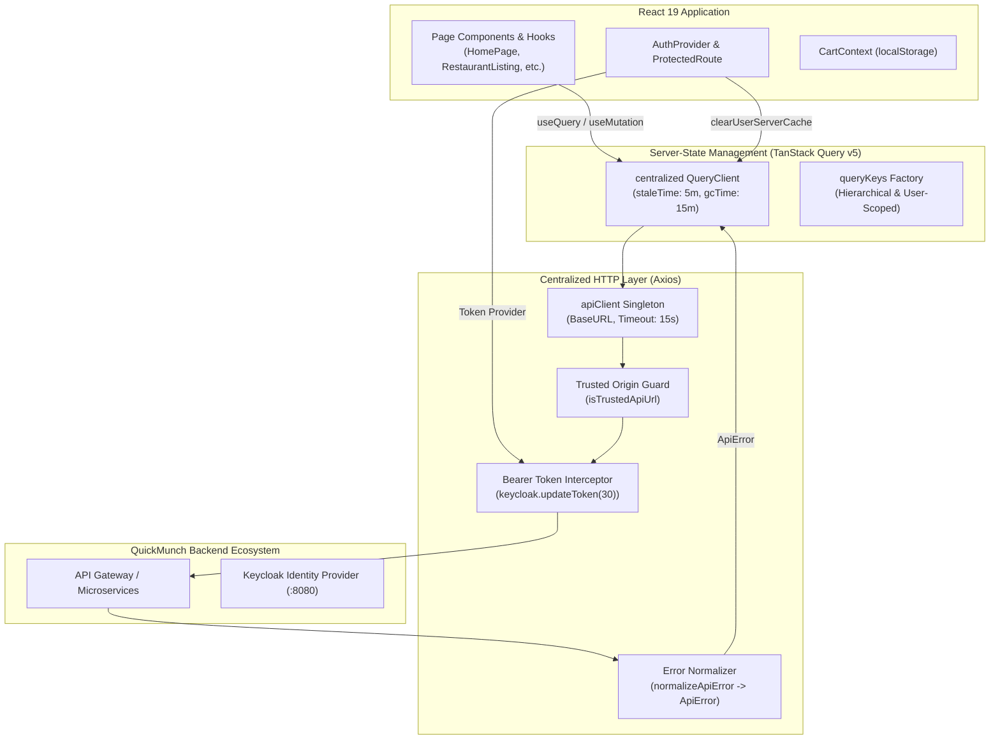

# QuickMunch — Frontend API Infrastructure & Architecture Guide

## 1. Overview

This document details the frontend API infrastructure for `quickmunch-client` (React 19, TypeScript, Vite, Tailwind CSS v4). It defines how the client interacts with QuickMunch's Spring Boot microservices ecosystem via a centralized, secure HTTP pipeline and TanStack Query server-state management.

---

## 2. Architecture Diagram



---

## 3. Centralized API Client Responsibilities

All HTTP communication flows through the centralized `apiClient` instance in [`src/api/client.ts`](file:///home/sefaul/Projects/QuickMunch/quickmunch-client/src/api/client.ts):

1. **Configurable Base URL**: Sourced from `import.meta.env.VITE_API_BASE_URL` (default: `http://localhost:8081`).
2. **Standard Timeouts**: Sourced from `import.meta.env.VITE_API_TIMEOUT_MS` (default: `15000ms`).
3. **Default Headers**: Enforces `Content-Type: application/json` and `Accept: application/json, text/plain, */*`.
4. **Multipart Handling**: Automatically deletes `Content-Type` for `FormData` payloads, enabling browsers to calculate boundary headers.
5. **Request Cancellation**: Fully respects standard `AbortController` and `signal` configs.

---

## 4. Authentication & Token Integration

Authentication is coordinated with Keycloak using **OAuth 2.0 Authorization Code Flow with PKCE (S256)**:

### Trusted Origin Guard
To guarantee tokens are never exposed to external or untrusted destinations, the request interceptor evaluates:
```typescript
if (tokenGetter && isTrustedApiUrl(config.url)) {
  const token = await tokenGetter();
  if (token && config.headers) {
    config.headers.Authorization = `Bearer ${token}`;
  }
}
```
- **Relative URLs** (`/api/...`) resolve to `API_BASE_URL` and are trusted.
- **Absolute URLs** matching `API_BASE_URL` origin are trusted.
- **Third-party / External URLs** (e.g. CDNs, analytics) are blocked from receiving Bearer tokens.

### Proactive Token Refresh
`tokenGetter` delegates to `keycloak.updateToken(30)`, which evaluates whether the access token expires within 30 seconds and refreshes it before dispatching the HTTP call.

---

## 5. TanStack Query Configuration

Server-state is managed through a singleton `QueryClient` in [`src/api/queryClient.ts`](file:///home/sefaul/Projects/QuickMunch/quickmunch-client/src/api/queryClient.ts):

| Setting | Default Value | Rationale |
| :--- | :--- | :--- |
| `staleTime` | `5 * 60 * 1000` (5 min) | Balances fresh data with eliminating unnecessary background refetches. |
| `gcTime` | `15 * 60 * 1000` (15 min) | Retains inactive cache for fast backward/forward navigation. |
| `refetchOnWindowFocus` | `false` | Prevents disruptive network bursts during normal tab switching. |
| `refetchOnReconnect` | `true` | Restores query freshness seamlessly when network connectivity resumes. |
| `retry` | `shouldRetryQuery` | Intelligent predicate: 0 retries for 4xx errors; 2 retries for 5xx/network errors. |
| `mutations.retry` | `false` | Prevents duplicate side-effects for non-idempotent mutations. |

---

## 6. Hierarchical Query Key Conventions

Query keys are defined in [`src/hooks/queries/queryKeys.ts`](file:///home/sefaul/Projects/QuickMunch/quickmunch-client/src/hooks/queries/queryKeys.ts):

```typescript
export const queryKeys = {
  all: ['quickmunch'] as const,

  users: {
    all: () => [...queryKeys.all, 'users'] as const,
    me: (userId?: string) => [...queryKeys.users.all(), 'me', userId ?? 'current'] as const,
    profile: (userId: string) => [...queryKeys.users.all(), 'profile', userId] as const,
  },

  restaurants: {
    all: () => [...queryKeys.all, 'restaurants'] as const,
    lists: () => [...queryKeys.restaurants.all(), 'list'] as const,
    list: (filters?: Record<string, unknown>) => [...queryKeys.restaurants.lists(), filters ?? {}] as const,
    details: () => [...queryKeys.restaurants.all(), 'detail'] as const,
    detail: (id: string | number) => [...queryKeys.restaurants.details(), String(id)] as const,
    menu: (id: string | number) => [...queryKeys.restaurants.detail(id), 'menu'] as const,
  },

  orders: {
    all: () => [...queryKeys.all, 'orders'] as const,
    lists: () => [...queryKeys.orders.all(), 'list'] as const,
    list: (filters?: Record<string, unknown>) => [...queryKeys.orders.lists(), filters ?? {}] as const,
    details: () => [...queryKeys.orders.all(), 'detail'] as const,
    detail: (id: string | number) => [...queryKeys.orders.details(), String(id)] as const,
  },
} as const;
```

> **Zero Cross-Account Leakage**: User-specific queries incorporate the user's Keycloak `sub` ID into the key hierarchy.

---

## 7. Standardized Error Normalization

Backend Spring Boot responses (from `user_service`, `restaurant_service`, and `order_service`) and network failures are normalized into the standard [`ApiError`](file:///home/sefaul/Projects/QuickMunch/quickmunch-client/src/api/apiError.ts) class:

```typescript
export class ApiError extends Error {
  readonly status?: number;
  readonly code?: string;
  readonly fieldErrors?: Record<string, string>;
  readonly timestamp?: string;
  readonly isNetworkError: boolean;
  readonly isTimeout: boolean;
  readonly isAuthError: boolean;
  readonly isValidationError: boolean;
  readonly isCanceled: boolean;
}
```

### Handled Status Codes & Mapping
- `400 / 422`: Mapped to `code: 'VALIDATION_ERROR'`. Extracts Spring Boot field errors map.
- `401`: Mapped to `code: 'UNAUTHORIZED'`. Triggers `unauthorizedHandler()` and clears session.
- `403`: Mapped to `code: 'FORBIDDEN'`. Differentiated from 401 without terminating login session.
- `404`: Mapped to `code: 'NOT_FOUND'`. Friendly resource not found message.
- `409`: Mapped to `code: 'CONFLICT'`. Unique constraint or business state conflicts.
- `429`: Mapped to `code: 'TOO_MANY_REQUESTS'`. Rate limit guidance.
- `500`: Mapped to `code: 'SERVER_ERROR'`. Safe user message, hides raw Java stack traces.
- `502 / 503 / 504`: Mapped to `code: 'GATEWAY_ERROR'`. Temporary upstream unavailability.
- `ERR_NETWORK`: Mapped to `code: 'NETWORK_ERROR'`. Clear offline/connectivity feedback.
- `ECONNABORTED`: Mapped to `code: 'TIMEOUT'`. Timeout feedback.

---

## 8. Authentication & Cache Lifecycle

1. **On Login**:
   - `AuthProvider` acquires the valid token.
   - User-scoped queries fetch fresh authenticated server state.
2. **On Logout & 401 Session Expiration**:
   - `clearUserServerCache()` removes all queries under `['quickmunch', 'users']` and `['quickmunch', 'orders']`.
   - Public queries (e.g. restaurant catalogs) remain cached for fast guest navigation.
   - **Local Storage State**: Client-side Shopping Cart (`quickmunch_cart`) and Favorites (`quickmunch_favorites`) remain persisted in `localStorage`.
3. **On Token Refresh**:
   - Queries are **not** invalidated. The session refreshes transparently in the background without UI interruption.

---

## 9. Developer Guide: How to Implement a New API Query

### Step 1: Add Endpoint Constant
In [`src/api/endpoints.ts`](file:///home/sefaul/Projects/QuickMunch/quickmunch-client/src/api/endpoints.ts):
```typescript
export const API_ENDPOINTS = {
  // ...
  RESTAURANTS: {
    DETAIL: (id: string | number) => `/api/restaurants/${id}`,
  },
};
```

### Step 2: Implement API Function
```typescript
import { apiClient } from '../api/client';
import { API_ENDPOINTS } from '../api/endpoints';

export interface RestaurantResponse {
  id: number;
  name: string;
  rating: number;
  cuisine: string;
}

export const fetchRestaurant = async (id: string | number): Promise<RestaurantResponse> => {
  const response = await apiClient.get<RestaurantResponse>(API_ENDPOINTS.RESTAURANTS.DETAIL(id));
  return response.data;
};
```

### Step 3: Implement Custom Hook with TanStack Query
```typescript
import { useQuery } from '@tanstack/react-query';
import { queryKeys } from './queryKeys';
import { fetchRestaurant } from '../../api/restaurants';
import type { ApiError } from '../../api/apiError';

export const useRestaurant = (id: string | number) => {
  return useQuery<RestaurantResponse, ApiError>({
    queryKey: queryKeys.restaurants.detail(id),
    queryFn: () => fetchRestaurant(id),
    enabled: Boolean(id),
  });
};
```

---

## 10. Developer Guide: How to Implement a New API Mutation

```typescript
import { useMutation, useQueryClient } from '@tanstack/react-query';
import { apiClient } from '../api/client';
import { queryKeys } from './queryKeys';
import type { ApiError } from '../api/apiError';

interface CreateOrderRequest {
  restaurantId: number;
  items: Array<{ foodItemId: number; quantity: number }>;
}

interface OrderResponse {
  id: number;
  status: string;
}

export const useCreateOrder = () => {
  const queryClient = useQueryClient();

  return useMutation<OrderResponse, ApiError, CreateOrderRequest>({
    mutationFn: async (payload) => {
      const response = await apiClient.post<OrderResponse>('/api/orders', payload);
      return response.data;
    },
    onSuccess: () => {
      // Invalidate active user order queries to fetch fresh status
      queryClient.invalidateQueries({ queryKey: queryKeys.orders.all() });
    },
  });
};
```

---

## 11. Testing Instructions

All infrastructure components are verified through automated unit tests with mocked network adapters:

```bash
cd quickmunch-client
npm test
```

- `src/tests/api/client.test.ts`: 10 tests covering token attachment, untrusted origin filtering, 401/403 handlers, and ApiError normalization.
- `src/tests/api/queryClient.test.ts`: 10 tests covering QueryClient defaults, intelligent retry predicate, and hierarchical query keys.
- `src/tests/auth/authCacheLifecycle.test.tsx`: Tests cache purging on logout without clearing localStorage cart/favorites.
- `src/tests/auth/auth.test.tsx`: 6 tests for Keycloak PKCE lifecycle.
- `src/tests/auth/protectedRoute.test.tsx`: 3 tests for route gating.
