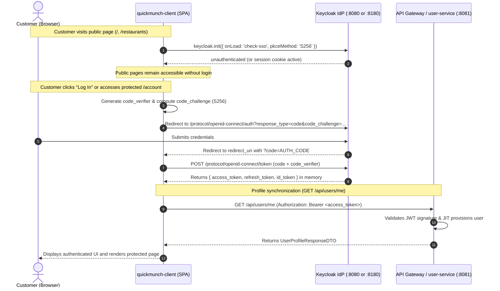

# QuickMunch — Frontend Authentication & Keycloak Integration

## 1. Overview

QuickMunch uses **OpenID Connect (OIDC)** and **OAuth 2.0 Authorization Code Flow with PKCE (Proof Key for Public Client Exchange, RFC 7636 / S256)** for customer authentication and authorization.

The identity provider is **Keycloak** (realm: `quickmunch`). The frontend (`quickmunch-client`) operates strictly as an OAuth 2.0 **Public Client** and **never** stores or possesses a client secret.

---

## 2. Keycloak Public Client Configuration

To configure Keycloak for the QuickMunch frontend, create or update a client in the `quickmunch` realm with these exact settings:

| Setting | Required Value | Rationale |
| :--- | :--- | :--- |
| **Client ID** | `quickmunch-client` | Matches `VITE_KEYCLOAK_CLIENT_ID` |
| **Client Protocol** | `openid-connect` | Standard OIDC flow |
| **Client Authentication** | `OFF` (Public Client) | Frontend SPAs cannot securely protect client secrets |
| **Standard Flow** | `ON` | Enables Authorization Code Flow with authorization endpoint redirect |
| **Direct Access Grants** | `OFF` | Password credentials flow is disabled for security |
| **Implicit Flow** | `OFF` | Deprecated and insecure; prohibited |
| **PKCE Code Challenge Method** | `S256` | Enforces SHA-256 code challenge exchange |
| **Valid Redirect URIs** | `http://localhost:5173/*`<br>`http://localhost:4173/*` | Allowed redirect destinations after login |
| **Valid Post Logout Redirect URIs** | `http://localhost:5173/*`<br>`http://localhost:4173/*` | Allowed return destinations after logout |
| **Web Origins** | `http://localhost:5173`<br>`http://localhost:4173` (or `+`) | Allows CORS requests for token exchange and userinfo |

---

## 3. Architecture & Authentication Flow



---

## 4. Token Lifecycle & Storage Security

### Memory-Only Token Storage
- **Zero Disk Exposure**: Access tokens and refresh tokens are **never** persisted to `localStorage`, `sessionStorage`, or custom browser cookies.
- **Session Persistence**: Authentication state survives page reloads through Keycloak's HTTP-only session cookie on Keycloak's origin (`check-sso`).
- **Mitigation of XSS Exposure**: Because tokens are kept exclusively in JavaScript memory, cross-site scripting vulnerabilities cannot steal persisted refresh tokens from browser storage.

### Automatic Token Refresh
- Before any protected API request is dispatched, the centralized API client calls `getAccessToken()`.
- `keycloak.updateToken(30)` evaluates whether the current access token will expire within 30 seconds.
- If nearing expiration, Keycloak silently exchanges the refresh token with the token endpoint.
- If the session is invalid or revoked, the 401 interceptor cleanly resets user session state without infinite redirect loops.

---

## 5. Frontend Module Structure

```
src/
├── auth/
│   ├── keycloak.ts          # Singleton Keycloak instance, PKCE S256 config, double-init guard
│   ├── AuthContext.ts       # Context definition & UserProfile interfaces
│   ├── AuthProvider.tsx     # State manager: token lifecycle, profile sync, login, logout
│   └── ProtectedRoute.tsx   # Route guard preserving return destination across login
├── api/
│   ├── client.ts            # Centralized Axios instance with Bearer interceptors & 401/403 handlers
│   └── users.ts             # Service calling GET /api/users/me
├── hooks/
│   └── useAuth.ts           # Consumer hook exposing { isAuthenticated, user, login, logout, ... }
└── pages/
    └── AccountPage.tsx      # Customer account dashboard & session management
```

---

## 6. Environment Configuration

Create a `.env` file in `quickmunch-client/` based on `.env.example`:

```env
# Keycloak Identity Provider URL
VITE_KEYCLOAK_URL=http://localhost:8080

# Keycloak Realm
VITE_KEYCLOAK_REALM=quickmunch

# Keycloak Public Client ID
VITE_KEYCLOAK_CLIENT_ID=quickmunch-client

# Backend Microservices / API Gateway Base URL
VITE_API_BASE_URL=http://localhost:8081
```

> **Note on Docker Compose Ports**: In local docker-compose environments where Keycloak is mapped to `8180:8080`, set `VITE_KEYCLOAK_URL=http://localhost:8180`.

---

## 7. How to Test Authentication Locally

1. **Start Infrastructure**:
   ```bash
   docker compose up -d postgres keycloak
   ```
2. **Start Backend User Service**:
   ```bash
   cd user_service && ./mvnw spring-boot:run
   ```
3. **Start Frontend**:
   ```bash
   cd quickmunch-client && npm run dev
   ```
4. **Automated Tests**:
   ```bash
   cd quickmunch-client && npm test
   ```
